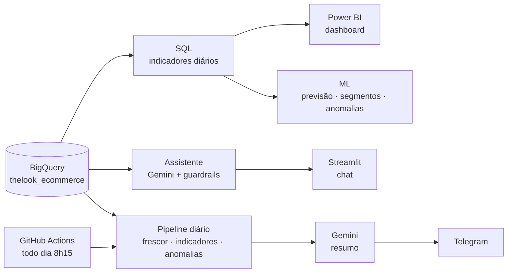
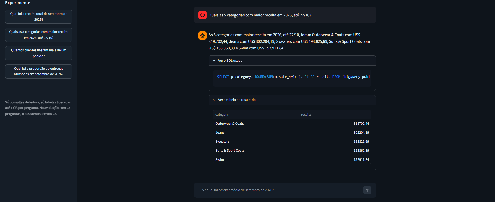
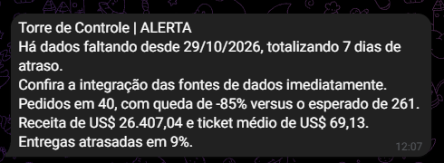

# Torre de Controle de E-commerce com IA

Sistema que acompanha a operação de uma loja online **do dado bruto ao alerta no celular**: indicadores em SQL, dashboard, modelos de machine learning, um assistente que responde perguntas em português e um pipeline que roda sozinho todo dia e manda o relatório no Telegram.

**Base de dados:** `bigquery-public-data.thelook_ecommerce`, base pública e sintética do Google, atualizada diariamente.

## Em 30 segundos

- **Dashboard no Power BI** com os indicadores da operação em janela de 7 dias, alimentado por uma tabela que o próprio projeto mantém no BigQuery.
- **Previsão de demanda:** 4 modelos comparados em backtest de 6 períodos. Uma tendência linear venceu o LightGBM e erra **25% menos que o baseline**, porque a série não tem sazonalidade. O modelo mais simples foi escolhido com base no número.
- **Segmentação de clientes** com RFM + K-Means: 3 segmentos (Fiéis, Ocasionais e Inativos), cada um com uma ação para o marketing.
- **Detecção de anomalias** que encontrou sozinha um salto artificial de pedidos e uma carga incompleta, **sem nenhum alarme falso** em 22 meses de histórico.
- **Assistente com IA:** pergunta em português, o Gemini escreve o SQL, travas de segurança conferem, o BigQuery roda e a resposta volta em português. **Acertou 25 de 25** no conjunto de avaliação.
- **Automação:** GitHub Actions roda o pipeline todo dia às 8h15, com login no Google Cloud **sem chave** e relatório no Telegram. A checagem de frescor detectou que a base parou de atualizar.
- **Engenharia:** 45 testes automáticos, CI a cada push, uma branch e um pull request por fase.

## Arquitetura



**Tecnologias:** SQL (BigQuery), Python (pandas, scikit-learn, LightGBM), MLflow, Power BI (DAX), Gemini (google-genai), Streamlit, GitHub Actions, Google Cloud (Workload Identity Federation), pytest.


## Fases

- [x] 0. Fundação: Git, repositório, acesso ao BigQuery, esqueleto e CI
- [x] 1. Dados e SQL: consultas de exploração, tabela de indicadores, dashboard
- [x] 2. ML: previsão de demanda, segmentação de clientes (RFM + K-Means), anomalias (MLflow)
- [x] 3. IA generativa: assistente texto-para-SQL com avaliação e guardrails
- [x] 4. Automação: pipeline diário com checagem de frescor e relatório no Telegram
- [x] 5. Vitrine: diagrama, demo e post

## Fase 1: dados, SQL e dashboard

**Como funciona**

1. As consultas de exploração em [`sql/01` a `sql/06`](sql/) respondem perguntas sobre pedidos, entregas, receita, devoluções e clientes.
2. [`sql/10_indicadores_diarios.sql`](sql/10_indicadores_diarios.sql) cria a tabela `torre_controle.indicadores_diarios` no BigQuery: uma linha por dia com pedidos, cancelamentos, receita, pedidos válidos, ticket médio, itens vendidos, taxa de devolução, entregas e taxa de atraso.
3. O Power BI lê essa tabela e calcula os indicadores com medidas DAX de janela móvel de 7 dias. As taxas são ponderadas pelo volume do dia: um dia com 300 entregas pesa mais que um dia com 30.

**O que os dados mostraram (e o que mudou no projeto)**

- **Prazo de entrega não depende de nada.** O tempo entre envio e entrega é uniforme de 0 a 4 dias em todos os centros de distribuição. Um modelo de previsão de atraso não aprenderia nada útil, então a Fase 2 vai prever **demanda**, que tem uma tendência clara de crescimento.
- **A devolução fica perto de 10% em todas as categorias.** As categorias que parecem "devolver mais" são as que vendem pouco: é efeito de amostra pequena, não problema de produto.
- **66,5% dos clientes compram uma vez só**, e ninguém passa de 4 pedidos. A segmentação vai se apoiar em recência e valor gasto, mais do que em frequência.
- **Os últimos dias têm um salto artificial de pedidos**, típico do gerador da base sintética. O dashboard fica filtrado até 18/10/2026, e os modelos usam dados só até 22/10/2026, o último dia normal.

## Fase 2: previsão de demanda

**Pergunta:** quantos pedidos a loja vai receber em cada dia da próxima semana?


**Como foi avaliado.** Em série temporal, o teste é sempre o futuro: nada de embaralhar os dados. Cada modelo usa só o que seria conhecido 7 dias antes do dia previsto e passa por um **backtest** em 6 períodos de 28 dias, para que um bom resultado não seja sorte de um mês específico.

| Modelo | Erro médio (MAE, pedidos/dia) | RMSE |
|---|---|---|
| **Tendência linear das últimas 4 semanas** | **11,2** | **14,3** |
| Média dos últimos 7 dias | 12,5 | 15,5 |
| LightGBM (calendário, lags e médias móveis) | 13,6 | 17,3 |
| Semana passada (baseline) | 14,9 | 18,3 |

**Por que o modelo mais simples venceu.** A série não tem efeito de dia da semana (todos os dias ficam entre 99% e 101% da média) e varia uns 10% em torno de uma tendência de crescimento. Sem padrão para aprender, o LightGBM acaba aprendendo o ruído. A reta das últimas 4 semanas erra **25% menos que o baseline**, e foi o modelo escolhido. O LightGBM continua no projeto como competidor, com tudo registrado no MLflow.

**Código:** [`src/demanda/`](src/demanda/), com testes em [`tests/`](tests/). Para reproduzir: `python -m src.demanda.dados` e depois `python -m src.demanda.backtest`.

## Fase 2: segmentação de clientes

**Pergunta:** quais grupos de clientes existem e o que fazer com cada um?

Cada cliente vira 3 números (**RFM**): **R**ecência (dias desde a última compra), **F**requência (número de pedidos) e **M** (valor gasto). A consulta está em [`sql/20_rfm_clientes.sql`](sql/20_rfm_clientes.sql). O **K-Means** agrupa os clientes depois de colocar as 3 medidas na mesma escala (com log no valor, porque poucos clientes gastam muito). O número de grupos foi escolhido pelo **silhouette score**: entre 2 e 8 grupos, o melhor foi **3** (0,377).

| Segmento | Clientes | Última compra | Pedidos | Gasto médio | O que fazer |
|---|---|---|---|---|---|
| **Fiéis** | 27% | há ~1 ano | 2,4 | US$ 228 | Programa de fidelidade e lançamentos antes de todo mundo. Não precisam de desconto para comprar. |
| **Ocasionais** | 50% | há ~1 ano | 1,0 | US$ 78 | É o maior potencial: cupom para a segunda compra, que é o passo que transforma ocasional em fiel. |
| **Inativos** | 23% | há ~4 anos | 1,1 | US$ 95 | Uma campanha barata de reativação. Quem não responder sai das campanhas pagas. |

**Código:** [`src/segmentacao/rfm.py`](src/segmentacao/rfm.py). Para reproduzir: rode o SQL no BigQuery e depois `python -m src.segmentacao.rfm`.

## Fase 2: detecção de anomalias

**Pergunta:** a operação teve algum dia fora do normal?

A tendência linear da previsão de demanda diz quantos pedidos eram **esperados** em cada dia. O detector mede quanto o real fugiu do esperado e compara com o ruído normal da série (medido com a **mediana**, que não é puxada pelas próprias anomalias). Um dia vira anomalia quando foge mais de **3,5 vezes** desse ruído.


| Dia | Pedidos | Esperado | Desvio |
|---|---|---|---|
| 24/10/2026 | 431 | 238 | +81% |
| 25/10/2026 | 533 | 241 | +121% |
| 26/10/2026 | 764 | 244 | +213% |
| 27/10/2026 | 998 | 251 | +298% |
| 28/10/2026 | 1.625 | 257 | +532% |
| 29/10/2026 | 40 | 261 | −85% |

O detector pegou sozinho o **salto artificial** que tinha sido encontrado na mão na Fase 1, e também a **queda** de 29/10, quando a carga da base veio incompleta. Em 22 meses de histórico normal, **nenhum alarme falso**.

**A escolha do limite é uma troca.** Com 3,0 o detector também pegaria o 23/10 (início do salto, nota 3,3), mas daria 5 alarmes falsos no histórico. Com 3,5 ele perde o primeiro dia e não incomoda à toa.

**Código:** [`src/demanda/anomalias.py`](src/demanda/anomalias.py). Para reproduzir: `python -m src.demanda.anomalias`.

## Fase 3: assistente com IA

**Pergunta:** e se qualquer pessoa da operação pudesse perguntar em português, sem saber SQL?



**Como funciona:**
1. O **Gemini** recebe a pergunta junto com a descrição de cada tabela e coluna e as regras dos dados (como o salto artificial depois de 22/10), e escreve o SQL. Ver [`contexto.py`](src/assistente/contexto.py).
2. Os **guardrails** conferem o SQL antes de rodar: só leitura, nenhum comando perigoso, um comando por vez, só as 4 tabelas liberadas e limite de linhas. Ver [`guardrails.py`](src/assistente/guardrails.py).
3. O BigQuery **estima o custo** (dry run) e barra consultas acima de 1 GB. Só então roda.
4. O Gemini lê o resultado e responde em português, sem inventar números. O SQL e a tabela ficam visíveis para conferência.

**Defesa em camadas.** Pedidos como "apague a tabela de clientes" são recusados pelo próprio modelo, que não escreve o SQL. Se um dia ele escrever, os guardrails barram: 12 testes automáticos tentam apagar tabelas, esconder comandos atrás de comentários ou de `;` e ler tabelas não liberadas.

**Avaliação.** Um conjunto de 25 perguntas com o SQL certo escrito à mão (indicadores, clientes, produtos com JOIN e 3 pedidos que devem ser recusados). O avaliador compara os **resultados**, não o texto do SQL. Ver [`avaliacao.py`](src/assistente/avaliacao.py).

| Rodada | Modelo principal | Acertos | Qualidade | Disponibilidade |
|---|---|---|---|---|
| 1 | gemini-flash | 24 de 25 | 24 de 24 | 24 de 25 (o Gemini não respondeu uma) |
| 2 | **gemini-flash-lite** | **25 de 25** | 25 de 25 | 25 de 25 |

Na primeira rodada o modelo principal ficou sobrecarregado quase o tempo todo e o modelo reserva (flash-lite) respondeu tudo. A avaliação mostrou que o modelo mais leve bastava, e ele virou o principal: mais rápido e sem perder qualidade.

**Limite honesto:** são 25 perguntas escritas por quem construiu o assistente. O próximo passo é ampliar o conjunto com perguntas mais difíceis e ambíguas.

**Para usar:** coloque `GEMINI_API_KEY` no `.env` e rode `streamlit run app.py`. Avaliação: `python -m src.assistente.avaliacao`.

## Fase 4: automação

**Pergunta:** e se o relatório da operação chegasse sozinho, todo dia, sem ninguém rodar nada?



**O pipeline diário** ([`src/pipeline/diario.py`](src/pipeline/diario.py)) roda no GitHub Actions todo dia às 8h15:
1. **Frescor:** confere se os dados de ontem chegaram. Um pipeline que roda com dados velhos produz relatórios errados sem ninguém perceber.
2. **Indicadores:** atualiza a tabela no BigQuery com o SQL da Fase 1.
3. **Anomalias:** roda o detector da Fase 2 no último dia.
4. **Resumo:** o Gemini escreve o relatório a partir dos números, já formatados para ele não errar casas decimais. Se o Gemini não responder, entra um texto padrão: o relatório nunca deixa de sair.
5. **Telegram:** a mensagem começa com **OK** ou **ALERTA**, para bater o olho e saber se precisa agir.

**Falha visível.** Se qualquer etapa quebrar, chega uma mensagem de FALHA no Telegram e a execução fica vermelha no GitHub.

**Login sem chave.** O Google Cloud bloqueia por padrão a criação de chaves de conta de serviço. O projeto usa **Workload Identity Federation**: o GitHub prova ao Google que é este repositório e recebe um acesso temporário. Não existe senha guardada que possa vazar, só este repositório é aceito, e a conta de serviço tem acesso apenas ao BigQuery.

**Na prática:** desde a primeira execução, o relatório chega com **ALERTA**, porque a base pública parou de atualizar em 29/10/2026. Foi a checagem de frescor que mostrou isso.

**Para rodar localmente:** `python -m src.pipeline.diario` (sem `TELEGRAM_TOKEN` no `.env`, o relatório só aparece na tela).

## Estrutura

```
├── sql/          # consultas versionadas
├── app.py        # interface de chat do assistente (Streamlit)
├── src/          # demanda, segmentação, assistente e pipeline diário
├── tests/        # testes automáticos
├── dashboard/    # arquivo do Power BI (.pbix)
├── docs/         # imagens, métricas e diagramas
└── .github/      # CI e agendamento do pipeline diário
```

## Como rodar

```bash
pip install -r requirements.txt
cp .env.example .env   # preencha com o seu projeto do GCP
pytest
```

Para o dashboard: rode `sql/10_indicadores_diarios.sql` no BigQuery e abra `dashboard/torre_controle.pbix` no Power BI Desktop.

## Sobre

Projeto de portfólio de **Rafael Simões**, com mais de 5 anos de experiência em logística e estudando Análise e Desenvolvimento de Sistemas. Construído com IA (Claude) como apoio no planejamento e na revisão do código.

[LinkedIn](https://www.linkedin.com/in/rafael-sim%C3%B5es-556979239) · [GitHub](https://github.com/rafaelsimoesdev)
