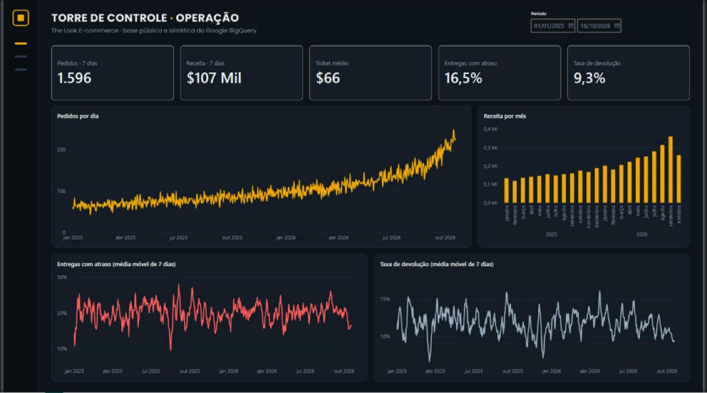
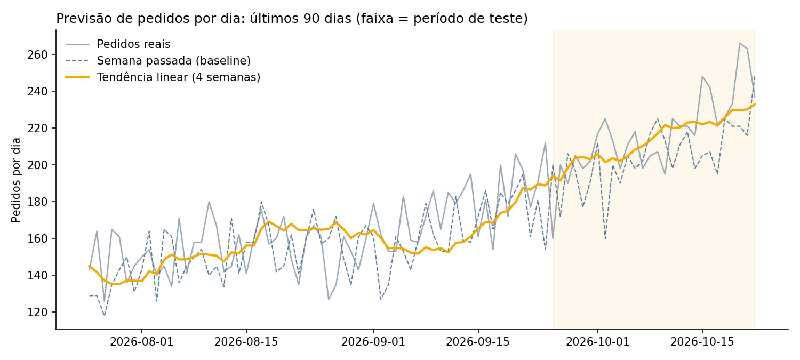
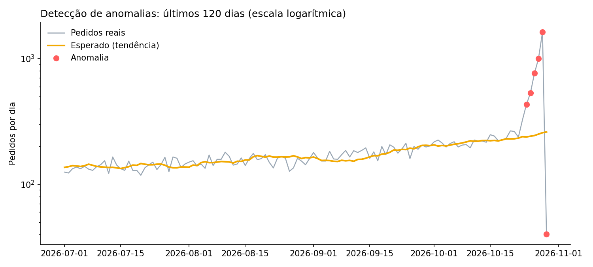

# Torre de Controle de E-commerce com IA

**Status:** em construção. Fase 2 de 5 concluída.

Sistema que acompanha a operação de uma loja online todo dia: carrega os pedidos novos, calcula indicadores, prevê a demanda, segmenta clientes, detecta anomalias e escreve um relatório diário com IA. Inclui um assistente que responde perguntas em português consultando o banco de dados.

**Base de dados:** `bigquery-public-data.thelook_ecommerce` (base pública e sintética do Google, com pedidos até a data atual).



## Fases

- [x] 0. Fundação: Git, repositório, acesso ao BigQuery, esqueleto e CI
- [x] 1. Dados e SQL: consultas de exploração, tabela de indicadores, dashboard
- [x] 2. ML: previsão de demanda, segmentação de clientes (RFM + K-Means), anomalias (MLflow)
- [ ] 3. IA generativa: assistente texto-para-SQL com avaliação e guardrails
- [ ] 4. Automação e MLOps: pipeline diário, drift, relatório no Telegram
- [ ] 5. Vitrine: diagrama, demo, post

## Fase 1: dados, SQL e dashboard

**Como funciona**

1. As consultas de exploração em [`sql/01` a `sql/06`](sql/) respondem perguntas sobre pedidos, entregas, receita, devoluções e clientes.
2. [`sql/10_indicadores_diarios.sql`](sql/10_indicadores_diarios.sql) cria a tabela `torre_controle.indicadores_diarios` no BigQuery: uma linha por dia com pedidos, cancelamentos, receita, pedidos válidos, ticket médio, itens vendidos, taxa de devolução, entregas e taxa de atraso.
3. O Power BI lê essa tabela e calcula os indicadores com medidas DAX de janela móvel de 7 dias. As taxas são ponderadas pelo volume do dia: um dia com 300 entregas pesa mais que um dia com 30.

**O que os dados mostraram (e o que mudou no projeto)**

- **Prazo de entrega não depende de nada.** O tempo entre envio e entrega é uniforme de 0 a 4 dias em todos os centros de distribuição. Um modelo de previsão de atraso não aprenderia nada útil, então a Fase 2 vai prever **demanda**, que tem uma tendência clara de crescimento.
- **A devolução fica perto de 10% em todas as categorias.** As categorias que parecem "devolver mais" são as que vendem pouco: é efeito de amostra pequena, não problema de produto.
- **66,5% dos clientes compram uma vez só**, e ninguém passa de 4 pedidos. A segmentação vai se apoiar em recência e valor gasto, mais do que em frequência.
- **Os últimos dias têm um salto artificial de pedidos**, típico do gerador da base sintética. O dashboard fica filtrado até 18/10/2026, e o modelo de demanda vai treinar só com dados de até 15 dias atrás.

## Fase 2: previsão de demanda

**Pergunta:** quantos pedidos a loja vai receber em cada dia da próxima semana?



**Como foi avaliado.** Em série temporal, o teste é sempre o futuro: nada de embaralhar os dados. Cada modelo usa só o que seria conhecido 7 dias antes do dia previsto e passa por um **backtest** em 6 períodos de 28 dias, para que um bom resultado não seja sorte de um mês específico.

| Modelo | Erro médio (MAE, pedidos/dia) | RMSE |
|---|---|---|
| **Tendência linear das últimas 4 semanas** | **11,2** | **14,3** |
| Média dos últimos 7 dias | 12,5 | 15,5 |
| LightGBM (calendário, lags e médias móveis) | 13,6 | 17,3 |
| Semana passada (baseline) | 14,9 | 18,3 |

**Por que o modelo mais simples venceu.** A série não tem efeito de dia da semana (todos os dias ficam entre 99% e 101% da média) e varia uns 10% em torno de uma tendência de crescimento. Sem padrão para aprender, o LightGBM acaba aprendendo o ruído. A reta das últimas 4 semanas erra **25% menos que o baseline**, e foi o modelo escolhido. O LightGBM continua no projeto como competidor, com tudo registrado no MLflow.

**Código:** [`src/demanda/`](src/demanda/), com testes em [`tests/`](tests/). Para reproduzir: `python -m src.demanda.dados` e depois `python -m src.demanda.backtest`.

## Fase 2: segmentação de clientes

**Pergunta:** quais grupos de clientes existem e o que fazer com cada um?

Cada cliente vira 3 números (**RFM**): **R**ecência (dias desde a última compra), **F**requência (número de pedidos) e **M** (valor gasto). A consulta está em [`sql/20_rfm_clientes.sql`](sql/20_rfm_clientes.sql). O **K-Means** agrupa os clientes depois de colocar as 3 medidas na mesma escala (com log no valor, porque poucos clientes gastam muito). O número de grupos foi escolhido pelo **silhouette score**: entre 2 e 8 grupos, o melhor foi **3** (0,377).

| Segmento | Clientes | Última compra | Pedidos | Gasto médio | O que fazer |
|---|---|---|---|---|---|
| **Fiéis** | 27% | há ~1 ano | 2,4 | US$ 228 | Programa de fidelidade e lançamentos antes de todo mundo. Não precisam de desconto para comprar. |
| **Ocasionais** | 50% | há ~1 ano | 1,0 | US$ 78 | É o maior potencial: cupom para a segunda compra, que é o passo que transforma ocasional em fiel. |
| **Inativos** | 23% | há ~4 anos | 1,1 | US$ 95 | Uma campanha barata de reativação. Quem não responder sai das campanhas pagas. |

**Código:** [`src/segmentacao/rfm.py`](src/segmentacao/rfm.py). Para reproduzir: rode o SQL no BigQuery e depois `python -m src.segmentacao.rfm`.

## Fase 2: detecção de anomalias

**Pergunta:** a operação teve algum dia fora do normal?

A tendência linear da previsão de demanda diz quantos pedidos eram **esperados** em cada dia. O detector mede quanto o real fugiu do esperado e compara com o ruído normal da série (medido com a **mediana**, que não é puxada pelas próprias anomalias). Um dia vira anomalia quando foge mais de **3,5 vezes** desse ruído.



| Dia | Pedidos | Esperado | Desvio |
|---|---|---|---|
| 24/10/2026 | 431 | 238 | +81% |
| 25/10/2026 | 533 | 241 | +121% |
| 26/10/2026 | 764 | 244 | +213% |
| 27/10/2026 | 998 | 251 | +298% |
| 28/10/2026 | 1.625 | 257 | +532% |
| 29/10/2026 | 40 | 261 | −85% |

O detector pegou sozinho o **salto artificial** que tinha sido encontrado na mão na Fase 1, e também a **queda** de 29/10, quando a carga da base veio incompleta. Em 22 meses de histórico normal, **nenhum alarme falso**.

**A escolha do limite é uma troca.** Com 3,0 o detector também pegaria o 23/10 (início do salto, nota 3,3), mas daria 5 alarmes falsos no histórico. Com 3,5 ele perde o primeiro dia e não incomoda à toa.

**Código:** [`src/demanda/anomalias.py`](src/demanda/anomalias.py). Para reproduzir: `python -m src.demanda.anomalias`.

## Estrutura

```
├── sql/          # consultas versionadas
├── src/          # código do pipeline, modelos e assistente
├── tests/        # testes automáticos
├── dashboard/    # arquivo do Power BI (.pbix)
├── docs/         # imagens, métricas e diagramas
└── .github/      # CI
```

## Como rodar

```bash
pip install -r requirements.txt
cp .env.example .env   # preencha com o seu projeto do GCP
pytest
```

Para o dashboard: rode `sql/10_indicadores_diarios.sql` no BigQuery e abra `dashboard/torre_controle.pbix` no Power BI Desktop.
