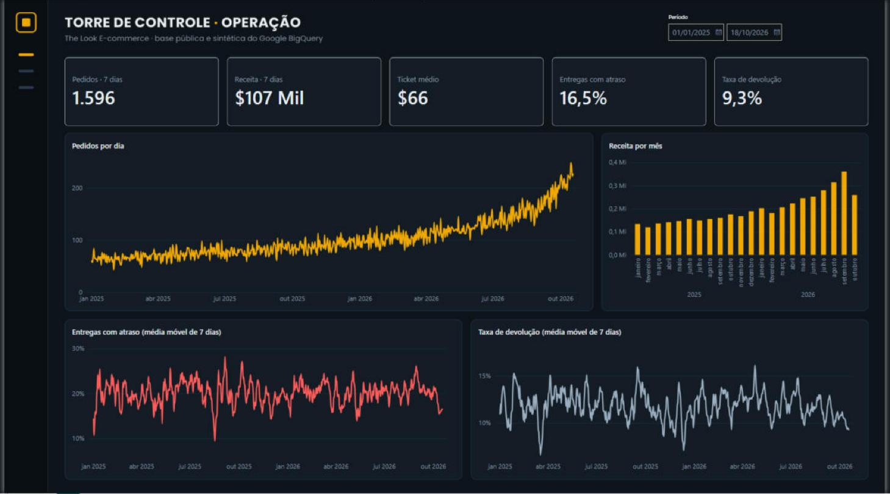

# Torre de Controle de E-commerce com IA

**Status:** em construção. Fase 1 de 5 concluída.

Sistema que acompanha a operação de uma loja online todo dia: carrega os pedidos novos, calcula indicadores, prevê a demanda, segmenta clientes, detecta anomalias e escreve um relatório diário com IA. Inclui um assistente que responde perguntas em português consultando o banco de dados.

**Base de dados:** `bigquery-public-data.thelook_ecommerce` (base pública e sintética do Google, com pedidos até a data atual).



## Fases

- [x] 0. Fundação: Git, repositório, acesso ao BigQuery, esqueleto e CI
- [x] 1. Dados e SQL: consultas de exploração, tabela de indicadores, dashboard
- [ ] 2. ML: previsão de demanda, segmentação de clientes (RFM + K-Means), anomalias (MLflow)
- [ ] 3. IA generativa: assistente texto-para-SQL com avaliação e guardrails
- [ ] 4. Automação e MLOps: pipeline diário, drift, relatório no Telegram
- [ ] 5. Vitrine: diagrama, demo, post

## Fase 1: dados, SQL e dashboard

**Como funciona**

1. As consultas de exploração em [`sql/01` a `sql/06`](sql/) respondem perguntas sobre pedidos, entregas, receita, devoluções e clientes.
2. [`sql/10_indicadores_diarios.sql`](sql/10_indicadores_diarios.sql) cria a tabela `torre_controle.indicadores_diarios` no BigQuery: uma linha por dia com pedidos, cancelamentos, receita, pedidos válidos, ticket médio, itens vendidos, taxa de devolução, entregas e taxa de atraso.
3. O Power BI lê essa tabela e calcula os indicadores com medidas DAX de janela móvel de 7 dias. As taxas são ponderadas pelo volume do dia: um dia com 300 entregas pesa mais que um dia com 30.

**O que os dados mostraram (e o que mudou no projeto)**

- **Prazo de entrega não depende de nada.** O tempo entre envio e entrega é uniforme de 0 a 4 dias em todos os centros de distribuição. Um modelo de previsão de atraso não aprenderia nada útil, então a Fase 2 vai prever **demanda**, que tem tendência e sazonalidade de verdade.
- **A devolução fica perto de 10% em todas as categorias.** As categorias que parecem "devolver mais" são as que vendem pouco: é efeito de amostra pequena, não problema de produto.
- **66,5% dos clientes compram uma vez só**, e ninguém passa de 4 pedidos. A segmentação vai se apoiar em recência e valor gasto, mais do que em frequência.
- **Os últimos dias têm um salto artificial de pedidos**, típico do gerador da base sintética. O dashboard fica filtrado até 18/10/2026, e o modelo de demanda vai treinar só com dados de até 15 dias atrás.

## Estrutura

```
├── sql/          # consultas versionadas
├── src/          # código do pipeline, modelos e assistente
├── tests/        # testes automáticos
├── dashboard/    # arquivo do Power BI (.pbix)
├── docs/         # imagens, métricas e diagramas
└── .github/      # CI
```

## Como rodar

```bash
pip install -r requirements.txt
cp .env.example .env   # preencha com o seu projeto do GCP
pytest
```

Para o dashboard: rode `sql/10_indicadores_diarios.sql` no BigQuery e abra `dashboard/torre_controle.pbix` no Power BI Desktop.
